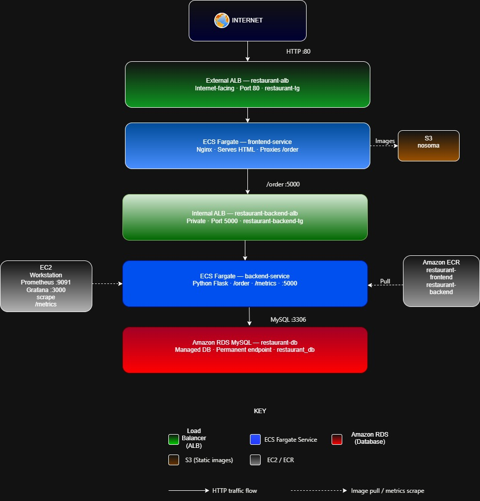

# 🍽️ African Restaurant App — AWS ECS + Fargate Deployment

**Deployed by:** Bemsimbom Nguma Ekfuingei Randy  
**Region:** us-east-2 (Ohio)  
**Stack:** Nginx · Flask · MySQL (RDS) · Docker · AWS ECS Fargate · ALB · Prometheus · Grafana

---

## 📖 What Is This Project?

This is a web application for an African restaurant. Customers can visit the website, view the menu, and place food orders. The app is made up of three parts:

| Part | What It Does | Technology |
|---|---|---|
| **Frontend** | The website the customer sees | Nginx (web server) |
| **Backend** | Handles orders and talks to the database | Python Flask |
| **Database** | Stores all food orders permanently | Amazon RDS MySQL |

The entire application runs on **AWS ECS Fargate** — meaning AWS manages the servers for us. We do not need to worry about patching, updating, or managing EC2 instances for the app itself.

---

## 🏗️ Architecture Overview

Here is how the pieces connect:



The same picture in text form:

```
                        INTERNET
                           │
                           ▼
              ┌────────────────────────┐
              │   External ALB         │  ← restaurant-alb (public)
              │   Port 80 (HTTP)       │
              └────────────┬───────────┘
                           │
                           ▼
              ┌────────────────────────┐
              │   ECS Fargate          │
              │   Frontend (Nginx)     │  ← Serves the website HTML
              └────────────┬───────────┘
                           │ /order requests
                           ▼
              ┌────────────────────────┐
              │   Internal ALB         │  ← restaurant-backend-alb (private)
              │   Port 5000 (HTTP)     │
              └────────────┬───────────┘
                           │
                           ▼
              ┌────────────────────────┐
              │   ECS Fargate          │
              │   Backend (Flask)      │  ← Processes orders, /metrics
              └────────────┬───────────┘
                           │
                           ▼
              ┌────────────────────────┐
              │   Amazon RDS MySQL     │  ← Stores orders permanently
              │   restaurant-db        │
              └────────────────────────┘

              ┌────────────────────────┐
              │   EC2 Workstation      │
              │   Prometheus :9091     │  ← Scrapes /metrics from backend
              │   Grafana     :3000    │  ← Visualizes the metrics
              └────────────────────────┘

              ┌────────────────────────┐
              │   Amazon S3            │
              │   Bucket: nosoma       │  ← Stores food images
              └────────────────────────┘
```

### Why Two Load Balancers?

- The **External ALB** (`restaurant-alb`) faces the internet. Customers connect to it on port 80 to see the website.
- The **Internal ALB** (`restaurant-backend-alb`) is private — only accessible inside AWS. The frontend uses it to reach the backend.

We need the internal ALB because ECS containers get a **new private IP address every time they restart**. If the frontend tried to connect directly to the backend's IP, it would break every time the backend restarted. The internal ALB always has the same DNS name, so the frontend connects to that stable name instead.

### Why RDS Instead of a MySQL Container?

Same reason. A MySQL container in ECS would get a new IP every restart, breaking all database connections. Amazon RDS has a **permanent endpoint address** that never changes, no matter how many times it is restarted or updated.

---

## 📁 Repository Structure

```
restaurant-app/
├── frontend/
│   ├── Dockerfile          # Builds the Nginx container image
│   ├── nginx.conf          # Nginx config — routes /order to the backend ALB
│   └── index.html          # The restaurant website
├── backend/
│   ├── Dockerfile          # Builds the Flask container image
│   ├── app.py              # Flask app — handles /order and /metrics
│   └── requirements.txt    # Python packages (flask, mysql-connector, prometheus-flask-exporter)
└── README.md               # This file
```

---

## ✅ Prerequisites

Before you begin, make sure you have:

- An **AWS account** with appropriate permissions (IAM, ECS, ECR, RDS, ALB, S3, CloudWatch)
- The **AWS CLI** installed and configured (or an EC2 instance with an IAM role attached)
- **Docker** installed
- **Git** installed
- A **GitHub** or **GitLab** account to clone the repository
- **MySQL client** installed (for database setup)

---

## 🚀 Deployment Guide

Follow these steps in order. Each step is explained so you understand what it does — not just copy-paste commands.

---

### Step 1 — Launch the EC2 Workstation

We use a small EC2 instance as our "command center" to build Docker images, push to ECR, and run Prometheus/Grafana for monitoring.

1. Go to **EC2 → Launch Instance** in the AWS Console
2. Choose **Amazon Linux 2** as the AMI
3. Instance type: **t3.micro** (free tier eligible)
4. Key pair: select or create a `.pem` key (save it — you'll need it to SSH in)
5. Security group: create a new one called `ecs-workstation-sg` with these inbound rules:

| Port | Protocol | Source | Purpose |
|---|---|---|---|
| 22 | SSH | Your IP | SSH access |
| 9091 | TCP | Your IP | Prometheus UI |
| 3000 | TCP | Your IP | Grafana UI |

6. Under **Advanced Details → IAM instance profile**, attach a role with these permissions:
   - `AmazonECS_FullAccess`
   - `AmazonEC2ContainerRegistryFullAccess`
   - `AmazonRDSFullAccess`
   - `CloudWatchLogsFullAccess`
   - `AmazonS3ReadOnlyAccess`

7. Launch the instance, then SSH in:

```bash
ssh -i /path/to/your-key.pem ec2-user@<instance-public-ip>
```

> 💡 **Note:** The public IP of your EC2 instance changes every time it restarts. Always check the current IP with:
> ```bash
> curl ifconfig.me
> ```

---

### Step 2 — Install Required Tools on the Workstation

Run these commands one at a time after SSHing into your EC2 instance.

**Install Docker:**
```bash
sudo yum install docker -y
sudo systemctl start docker
sudo systemctl enable docker
sudo usermod -aG docker ec2-user
```

Log out and log back in so the `docker` group takes effect:
```bash
exit
ssh -i /path/to/your-key.pem ec2-user@<instance-public-ip>
```

**Verify Docker works:**
```bash
docker ps
```

**Install MySQL client (for connecting to RDS later):**
```bash
sudo dnf install mariadb105 -y
```

**Verify MySQL client works:**
```bash
mysql --version
```

**Install Git:**
```bash
sudo yum install git -y
```

---

### Step 3 — Clone the Repository

```bash
git clone https://github.com/bemsimbomrandy93-netizen/restaurant-app.git
cd restaurant-app
```

---

### Step 4 — Create ECR Repositories

ECR (Elastic Container Registry) is where we store our Docker images on AWS.

**Authenticate Docker to ECR** (do this at the start of every session — the token expires after 12 hours):
```bash
aws ecr get-login-password --region us-east-2 | \
  docker login --username AWS --password-stdin \
  452110701663.dkr.ecr.us-east-2.amazonaws.com
```

**Create the frontend repository:**
```bash
aws ecr create-repository --repository-name restaurant-frontend --region us-east-2
```

**Create the backend repository:**
```bash
aws ecr create-repository --repository-name restaurant-backend --region us-east-2
```

---

### Step 5 — Build and Push Docker Images

**Build and push the frontend image:**
```bash
cd ~/restaurant-app/frontend

docker build -t restaurant-frontend .

docker tag restaurant-frontend:latest \
  452110701663.dkr.ecr.us-east-2.amazonaws.com/restaurant-frontend:latest

docker push \
  452110701663.dkr.ecr.us-east-2.amazonaws.com/restaurant-frontend:latest
```

**Build and push the backend image:**
```bash
cd ~/restaurant-app/backend

docker build -t restaurant-backend .

docker tag restaurant-backend:latest \
  452110701663.dkr.ecr.us-east-2.amazonaws.com/restaurant-backend:latest

docker push \
  452110701663.dkr.ecr.us-east-2.amazonaws.com/restaurant-backend:latest
```

---

### Step 6 — Set Up the Database (Amazon RDS)

Instead of running MySQL in a container (which would get a new IP every restart), we use **Amazon RDS** — a managed database service with a permanent, stable address.

**Create the RDS instance:**

1. Go to **RDS → Create database** in the AWS Console
2. Choose **Standard Create**
3. Engine: **MySQL**, Version: **8.4.9**
4. Template: **Free tier** (or Sandbox)
5. DB instance identifier: `restaurant-db`
6. Master username: `admin`
7. Master password: `rootpassword` *(change this in production!)*
8. Instance class: `db.t4g.micro`
9. Storage: 20 GB gp2
10. VPC: choose the **default VPC**
11. Public access: **No**
12. Create a new security group or use an existing one — make sure port **3306** is open from the ECS security group

Wait for the RDS instance status to show **Available** (this takes 3–5 minutes).

**Find the RDS endpoint:**

Go to **RDS → Databases → restaurant-db → Connectivity & Security**. Copy the endpoint. It will look like:
```
restaurant-db.xxxxxxxx.us-east-2.rds.amazonaws.com
```

**Connect to RDS and create the database:**
```bash
mysql -h restaurant-db.xxxxxxxx.us-east-2.rds.amazonaws.com -u admin -prootpassword
```

Once connected, run:
```sql
CREATE DATABASE restaurant_db;
USE restaurant_db;

CREATE TABLE orders (
  id INT AUTO_INCREMENT PRIMARY KEY,
  food VARCHAR(255) NOT NULL,
  created_at TIMESTAMP DEFAULT CURRENT_TIMESTAMP
);

EXIT;
```

---

### Step 7 — Create the ECS Cluster

An ECS cluster is the "container" (not Docker container — more like a folder) that holds all our ECS services and tasks.

```bash
aws ecs create-cluster --cluster-name restaurant-cluster --region us-east-2
```

---

### Step 8 — Create the Security Group for ECS

This security group controls what traffic can reach our ECS containers.

```bash
aws ec2 create-security-group \
  --group-name restaurant-ecs-sg \
  --description "Security group for restaurant ECS services" \
  --region us-east-2
```

Note the `GroupId` returned (it looks like `sg-xxxxxxxxxxxxxxxxx`). Now add the inbound rules:

```bash
# Allow HTTP (for Nginx frontend)
aws ec2 authorize-security-group-ingress \
  --group-id sg-xxxxxxxxxxxxxxxxx \
  --protocol tcp --port 80 --cidr 0.0.0.0/0 \
  --region us-east-2

# Allow Flask backend
aws ec2 authorize-security-group-ingress \
  --group-id sg-xxxxxxxxxxxxxxxxx \
  --protocol tcp --port 5000 --cidr 0.0.0.0/0 \
  --region us-east-2

# Allow Prometheus metrics
aws ec2 authorize-security-group-ingress \
  --group-id sg-xxxxxxxxxxxxxxxxx \
  --protocol tcp --port 9091 --cidr 0.0.0.0/0 \
  --region us-east-2
```

---

### Step 9 — Create ECS Task Definitions

A task definition tells ECS: "here is the container image to use, how much CPU/memory to give it, what ports to expose, and what environment variables to set."

**Backend Task Definition:**

Create a file called `backend-task-def.json`:

```json
{
  "family": "restaurant-backend",
  "networkMode": "awsvpc",
  "requiresCompatibilities": ["FARGATE"],
  "cpu": "512",
  "memory": "1024",
  "executionRoleArn": "arn:aws:iam::452110701663:role/ecsTaskExecutionRole",
  "containerDefinitions": [
    {
      "name": "backend",
      "image": "452110701663.dkr.ecr.us-east-2.amazonaws.com/restaurant-backend:latest",
      "portMappings": [
        {
          "containerPort": 5000,
          "protocol": "tcp"
        }
      ],
      "environment": [
        { "name": "DB_HOST", "value": "restaurant-db.xxxxxxxx.us-east-2.rds.amazonaws.com" },
        { "name": "DB_USER", "value": "admin" },
        { "name": "DB_PASSWORD", "value": "rootpassword" },
        { "name": "DB_NAME", "value": "restaurant_db" }
      ],
      "logConfiguration": {
        "logDriver": "awslogs",
        "options": {
          "awslogs-group": "/ecs/backend-service",
          "awslogs-region": "us-east-2",
          "awslogs-stream-prefix": "ecs",
          "awslogs-create-group": "true"
        }
      }
    }
  ]
}
```

Register it:
```bash
aws ecs register-task-definition \
  --cli-input-json file://backend-task-def.json \
  --region us-east-2
```

> ⚠️ **Important:** The environment variable names (`DB_HOST`, `DB_USER`, `DB_PASSWORD`, `DB_NAME`) must match **exactly** what `app.py` reads with `os.environ[...]`. A mismatch causes a silent HTTP 500 error.

**Frontend Task Definition:**

Create a file called `frontend-task-def.json`:

```json
{
  "family": "restaurant-frontend",
  "networkMode": "awsvpc",
  "requiresCompatibilities": ["FARGATE"],
  "cpu": "512",
  "memory": "1024",
  "executionRoleArn": "arn:aws:iam::452110701663:role/ecsTaskExecutionRole",
  "containerDefinitions": [
    {
      "name": "frontend",
      "image": "452110701663.dkr.ecr.us-east-2.amazonaws.com/restaurant-frontend:latest",
      "portMappings": [
        {
          "containerPort": 80,
          "protocol": "tcp"
        }
      ],
      "logConfiguration": {
        "logDriver": "awslogs",
        "options": {
          "awslogs-group": "/ecs/frontend-service",
          "awslogs-region": "us-east-2",
          "awslogs-stream-prefix": "ecs",
          "awslogs-create-group": "true"
        }
      }
    }
  ]
}
```

Register it:
```bash
aws ecs register-task-definition \
  --cli-input-json file://frontend-task-def.json \
  --region us-east-2
```

---

### Step 10 — Create the Internal ALB for the Backend

The internal ALB gives the backend a **stable, permanent DNS name** so the frontend can always reach it — even after the backend container restarts and gets a new private IP.

1. Go to **EC2 → Load Balancers → Create Load Balancer**
2. Choose **Application Load Balancer**
3. Name: `restaurant-backend-alb`
4. Scheme: **Internal** ← very important
5. VPC: default VPC
6. Subnets: select all 3 available subnets
7. Security groups: `restaurant-ecs-sg`
8. Listener: **HTTP, Port 5000**
9. Target group: create new
   - Name: `restaurant-backend-tg`
   - Target type: **IP**
   - Protocol: HTTP, Port: 5000
   - Health check path: `/metrics`
   - Health check success codes: `200`
10. Create the load balancer

Note the internal ALB DNS name — it will look like:
```
internal-restaurant-backend-alb-xxxxxxxxxx.us-east-2.elb.amazonaws.com
```

---

### Step 11 — Update nginx.conf with the Internal ALB DNS

The frontend's Nginx needs to know where to send order requests. Open `frontend/nginx.conf` and make sure it contains:

```nginx
server {
    listen 80;

    location / {
        root /usr/share/nginx/html;
        index index.html;
    }

    location /order {
        resolver 169.254.169.253 valid=10s ipv6=off;
        set $backend "internal-restaurant-backend-alb-xxxxxxxxxx.us-east-2.elb.amazonaws.com";
        proxy_pass http://$backend:5000/order;
        proxy_set_header Content-Type application/json;
    }
}
```

Replace `internal-restaurant-backend-alb-xxxxxxxxxx.us-east-2.elb.amazonaws.com` with your actual internal ALB DNS name.

> 💡 **Why `set $backend`?** Nginx resolves hostnames when it starts up and caches the result. If we wrote `proxy_pass http://hostname/`, and the IP behind that hostname changed, nginx would still send to the old IP. By using `set $backend`, we force nginx to re-resolve the DNS on every request — so it always finds the correct IP.

After editing `nginx.conf`, rebuild and push the frontend image:

```bash
cd ~/restaurant-app/frontend

docker build -t restaurant-frontend .

docker tag restaurant-frontend:latest \
  452110701663.dkr.ecr.us-east-2.amazonaws.com/restaurant-frontend:latest

docker push \
  452110701663.dkr.ecr.us-east-2.amazonaws.com/restaurant-frontend:latest
```

---

### Step 12 — Create the Backend ECS Service

```bash
aws ecs create-service \
  --cluster restaurant-cluster \
  --service-name backend-service \
  --task-definition restaurant-backend \
  --desired-count 1 \
  --launch-type FARGATE \
  --network-configuration "awsvpcConfiguration={
    subnets=[subnet-0a211c7fc9ad10888,subnet-09f3b006c645be23a,subnet-07d951fbc55eab965],
    securityGroups=[sg-03aa4b64d1da2f117],
    assignPublicIp=ENABLED
  }" \
  --load-balancers "targetGroupArn=arn:aws:elasticloadbalancing:us-east-2:452110701663:targetgroup/restaurant-backend-tg/xxxxxxxx,containerName=backend,containerPort=5000" \
  --region us-east-2
```

Wait for the service to show 1 running task before continuing.

---

### Step 13 — Create the External ALB for the Frontend

This is the public-facing load balancer that customers connect to.

1. Go to **EC2 → Load Balancers → Create Load Balancer**
2. Choose **Application Load Balancer**
3. Name: `restaurant-alb`
4. Scheme: **Internet-facing** ← public access
5. VPC: default VPC
6. Subnets: select all 3 available subnets
7. Security groups: `restaurant-ecs-sg`
8. Listener: **HTTP, Port 80**
9. Target group: create new
   - Name: `restaurant-tg`
   - Target type: **IP**
   - Protocol: HTTP, Port: 80
   - Health check path: `/`
   - Health check success codes: `200`
10. Create the load balancer

Note the external ALB DNS name — this is the **public URL of your app**.

---

### Step 14 — Create the Frontend ECS Service

```bash
aws ecs create-service \
  --cluster restaurant-cluster \
  --service-name frontend-service \
  --task-definition restaurant-frontend \
  --desired-count 1 \
  --launch-type FARGATE \
  --network-configuration "awsvpcConfiguration={
    subnets=[subnet-0a211c7fc9ad10888,subnet-09f3b006c645be23a,subnet-07d951fbc55eab965],
    securityGroups=[sg-03aa4b64d1da2f117],
    assignPublicIp=ENABLED
  }" \
  --load-balancers "targetGroupArn=arn:aws:elasticloadbalancing:us-east-2:452110701663:targetgroup/restaurant-tg/xxxxxxxx,containerName=frontend,containerPort=80" \
  --region us-east-2
```

---

### Step 15 — Verify the Application

Wait 2–3 minutes for both services to start and for the ALB health checks to pass.

**Check that ECS services are running:**
```bash
aws ecs list-services --cluster restaurant-cluster --region us-east-2
```

**Check service status:**
```bash
aws ecs describe-services \
  --cluster restaurant-cluster \
  --services frontend-service backend-service \
  --region us-east-2 \
  --query 'services[*].{name:serviceName,running:runningCount,desired:desiredCount}'
```

**Open the app in a browser:**

Navigate to the external ALB DNS name:
```
http://restaurant-alb-xxxxxxxxxx.us-east-2.elb.amazonaws.com
```

You should see the restaurant website. Try placing an order!

**Verify the order was saved in the database:**
```bash
mysql -h restaurant-db.xxxxxxxx.us-east-2.rds.amazonaws.com -u admin -prootpassword
```
```sql
USE restaurant_db;
SELECT * FROM orders;
```

You should see your order in the table. ✅

---

### Step 16 — Set Up Prometheus Monitoring

Prometheus is a tool that collects numbers (metrics) from our backend over time — things like how many requests were made, how much memory is being used, etc.

**Download and extract Prometheus on your EC2 workstation:**
```bash
cd ~
wget https://github.com/prometheus/prometheus/releases/download/v2.45.0/prometheus-2.45.0.linux-amd64.tar.gz
tar xvf prometheus-2.45.0.linux-amd64.tar.gz
cd prometheus-2.45.0.linux-amd64
```

**Get the current backend task private IP:**
```bash
# First, get the task ARN
TASK_ARN=$(aws ecs list-tasks \
  --cluster restaurant-cluster \
  --service-name backend-service \
  --region us-east-2 \
  --query 'taskArns[0]' \
  --output text)

# Then get the private IP
aws ecs describe-tasks \
  --cluster restaurant-cluster \
  --tasks $TASK_ARN \
  --region us-east-2 \
  --query 'tasks[0].containers[0].networkInterfaces[0].privateIpv4Address' \
  --output text
```

**Edit the Prometheus config file:**
```bash
nano prometheus.yml
```

Replace the contents with:
```yaml
global:
  scrape_interval: 15s

scrape_configs:
  - job_name: 'flask-backend'
    static_configs:
      - targets: ['<backend-private-ip>:5000']
    metrics_path: '/metrics'
```

Replace `<backend-private-ip>` with the IP from the command above.

**Start Prometheus:**
```bash
./prometheus --config.file=prometheus.yml --web.listen-address=0.0.0.0:9091 &
```

**Verify Prometheus is running:**

Open in your browser: `http://<ec2-workstation-public-ip>:9091`

Go to **Status → Targets** and confirm the flask-backend target shows **UP**.

---

### Step 17 — Set Up Grafana Dashboards

Grafana turns Prometheus numbers into visual graphs.

**Download and extract Grafana:**
```bash
cd ~
wget https://dl.grafana.com/oss/release/grafana-10.2.0.linux-amd64.tar.gz
tar xvf grafana-10.2.0.linux-amd64.tar.gz
cd grafana-10.2.0
```

**Start Grafana:**
```bash
./bin/grafana-server &
```

**Open Grafana:**

Navigate to: `http://<ec2-workstation-public-ip>:3000`

Default login: `admin` / `admin` (you'll be asked to change the password)

**Add Prometheus as a data source:**

1. Click the hamburger menu (☰) → **Connections → Data Sources**
2. Click **Add data source**
3. Choose **Prometheus**
4. URL: `http://<ec2-workstation-public-ip>:9091`
5. Click **Save & Test** — you should see "Successfully queried the Prometheus API."

**Create a dashboard:**

1. Click **+** → **New Dashboard** → **Add visualization**
2. Select **Prometheus** as the data source

Add these three panels:

**Panel 1 — Backend Memory Usage:**
```promql
process_resident_memory_bytes
```
Title: `Backend Memory Usage`

**Panel 2 — HTTP Request Rate:**
```promql
rate(flask_http_request_total[1m])
```
Title: `HTTP Request Rate`

**Panel 3 — Backend CPU Usage:**
```promql
process_cpu_seconds_total
```
Title: `Backend CPU Usage`

Save the dashboard with a name like `Restaurant App Monitoring`.

> 💡 **If the HTTP Request Rate panel shows no data:** Generate some traffic first:
> ```bash
> for i in {1..20}; do
>   curl -s -X POST http://<backend-private-ip>:5000/order \
>     -H "Content-Type: application/json" \
>     -d '{"food":"Eru"}' > /dev/null
> done
> ```
> Then refresh the panel.

---

## 🔑 Key Resource Reference

| Resource | Name / Value |
|---|---|
| AWS Account | 452110701663 |
| Region | us-east-2 (Ohio) |
| ECS Cluster | restaurant-cluster |
| Frontend Service | frontend-service |
| Backend Service | backend-service |
| External ALB | restaurant-alb |
| Internal ALB | restaurant-backend-alb |
| Frontend Target Group | restaurant-tg |
| Backend Target Group | restaurant-backend-tg |
| RDS Endpoint | restaurant-db.c3ucyq6omm1m.us-east-2.rds.amazonaws.com |
| DB Name | restaurant_db |
| DB User | admin |
| ECS Security Group | restaurant-ecs-sg (sg-03aa4b64d1da2f117) |
| S3 Bucket (food images) | nosoma |

---

## 💰 Cost Control — Pausing Resources When Not in Use

AWS charges for resources that are running. When you are done for the day, you can reduce costs by scaling down:

**Scale ECS services to 0 (pause the containers):**
```bash
aws ecs update-service \
  --cluster restaurant-cluster \
  --service frontend-service \
  --desired-count 0 \
  --region us-east-2

aws ecs update-service \
  --cluster restaurant-cluster \
  --service backend-service \
  --desired-count 0 \
  --region us-east-2
```

**Scale back up when ready to use:**
```bash
aws ecs update-service \
  --cluster restaurant-cluster \
  --service frontend-service \
  --desired-count 1 \
  --region us-east-2

aws ecs update-service \
  --cluster restaurant-cluster \
  --service backend-service \
  --desired-count 1 \
  --region us-east-2
```

**Stop RDS when not needed:**

Go to **RDS → Databases → restaurant-db → Actions → Stop temporarily**.
RDS will auto-restart after 7 days. Your data is preserved.

**Stop the EC2 workstation:**
```bash
# From the AWS Console: EC2 → Instances → select instance → Instance state → Stop
```

---

## 🧹 Cleanup — Deleting Everything

If you want to completely tear down this project:

```bash
# 1. Delete ECS services
aws ecs update-service --cluster restaurant-cluster --service frontend-service --desired-count 0 --region us-east-2
aws ecs update-service --cluster restaurant-cluster --service backend-service --desired-count 0 --region us-east-2
aws ecs delete-service --cluster restaurant-cluster --service frontend-service --force --region us-east-2
aws ecs delete-service --cluster restaurant-cluster --service backend-service --force --region us-east-2

# 2. Delete ECS cluster
aws ecs delete-cluster --cluster restaurant-cluster --region us-east-2

# 3. Delete ECR repositories
aws ecr delete-repository --repository-name restaurant-frontend --force --region us-east-2
aws ecr delete-repository --repository-name restaurant-backend --force --region us-east-2

# 4. Delete load balancers and target groups via AWS Console:
#    EC2 → Load Balancers → select → Actions → Delete
#    EC2 → Target Groups → select → Actions → Delete

# 5. Delete RDS instance via AWS Console:
#    RDS → Databases → restaurant-db → Actions → Delete

# 6. Terminate EC2 workstation via AWS Console:
#    EC2 → Instances → select → Instance state → Terminate
```

---

## ⚠️ Common Mistakes and How to Avoid Them

These are real mistakes encountered during this deployment. They are documented here so you do not repeat them.

| Mistake | What Happened | What to Do Instead |
|---|---|---|
| **Wrong env var names** | Task definition used `MYSQL_HOST` but app.py reads `DB_HOST` — caused silent HTTP 500 | Always match env var names exactly between task definition and `os.environ[]` in the code |
| **Using container names as hostnames in ECS** | Tried to connect nginx to `backend` like Docker Compose — ECS has no such DNS | Use an internal ALB for service-to-service communication in ECS |
| **Hardcoded container IPs** | Used a backend private IP directly in nginx.conf — broke every time the task restarted | Use the internal ALB DNS name with `set $backend` in nginx |
| **ECR login expired** | Docker push failed after 12 hours — the ECR auth token expired | Re-run the `aws ecr get-login-password` login command at the start of every session |
| **Wrong security group for RDS** | Added port 3306 to the ECS security group, but RDS has its own separate security group | Add the inbound rule to the security group that is **attached to RDS**, not ECS |
| **MySQL container instead of RDS** | MySQL in ECS got a new IP every restart, breaking the backend's DB connection | Use Amazon RDS — its endpoint never changes |
| **Assuming "Running" = "Working"** | ECS task showed "Running" status but app returned 500 errors | Always test end-to-end: place a real order in the browser and verify it in the database |

---

## 📚 What I Learned

This project taught me the difference between running an app locally and deploying it in a production-grade cloud environment. The main lessons:

1. **Cloud infrastructure has layers.** Every layer (DNS, load balancer, security group, container, app code, database) can be a source of problems. Learn each layer separately.

2. **Ephemeral IPs are a real problem.** In the cloud, container IPs change constantly. The correct solution is to always put a stable DNS endpoint (like an ALB or RDS endpoint) in front of any service others need to reach.

3. **Read the error message.** Every error message tells you the truth about what went wrong. Reading carefully is faster than guessing.

4. **Fix one thing at a time.** When multiple bugs are active simultaneously, change one thing, test, then move to the next. This saves enormous time.

5. **Managed services (RDS, ALB) exist for a reason.** They handle the hard parts — stability, health checks, automatic failover — so you can focus on your application.

---

*Built with real sweat, real errors, and real fixes. 🛠️*
